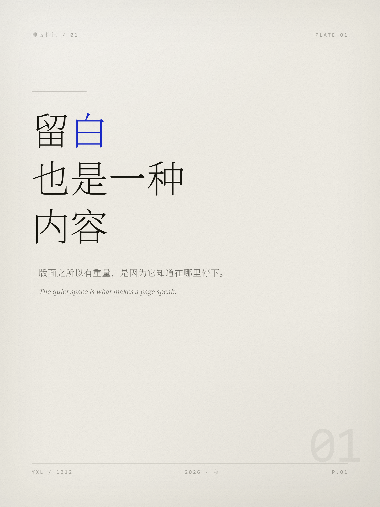
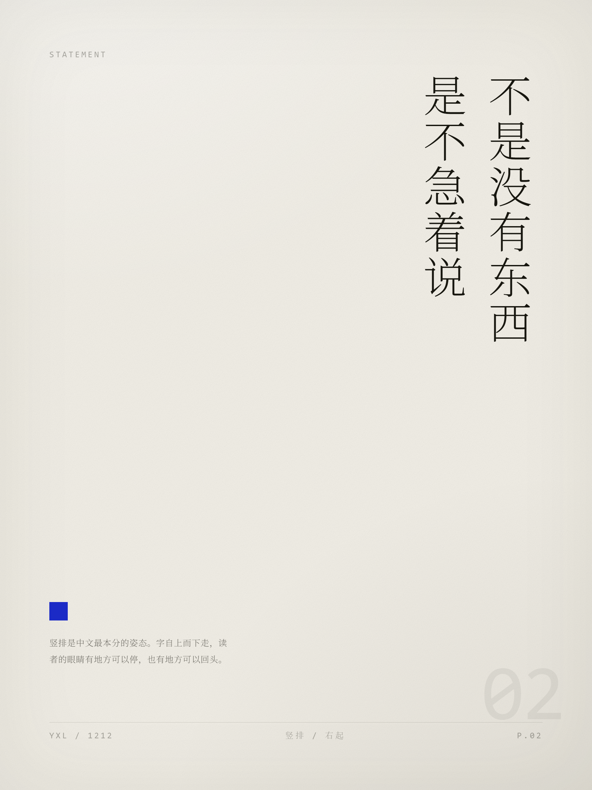
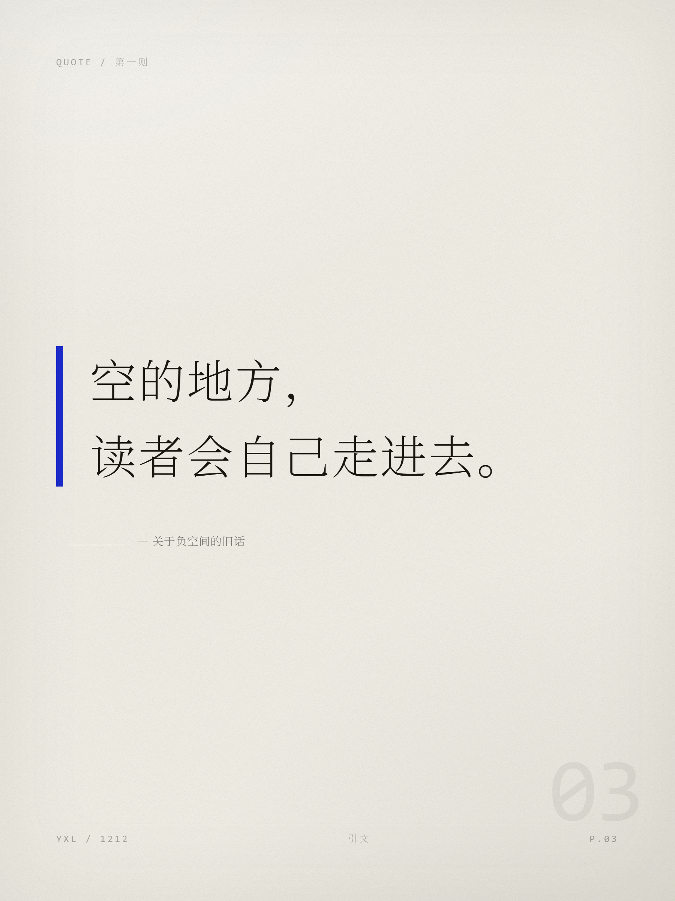
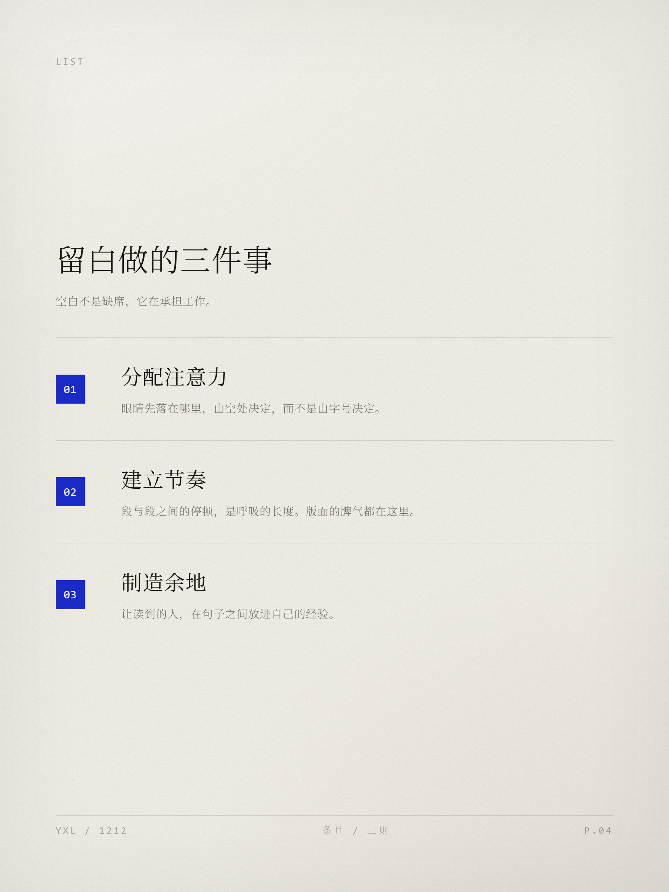
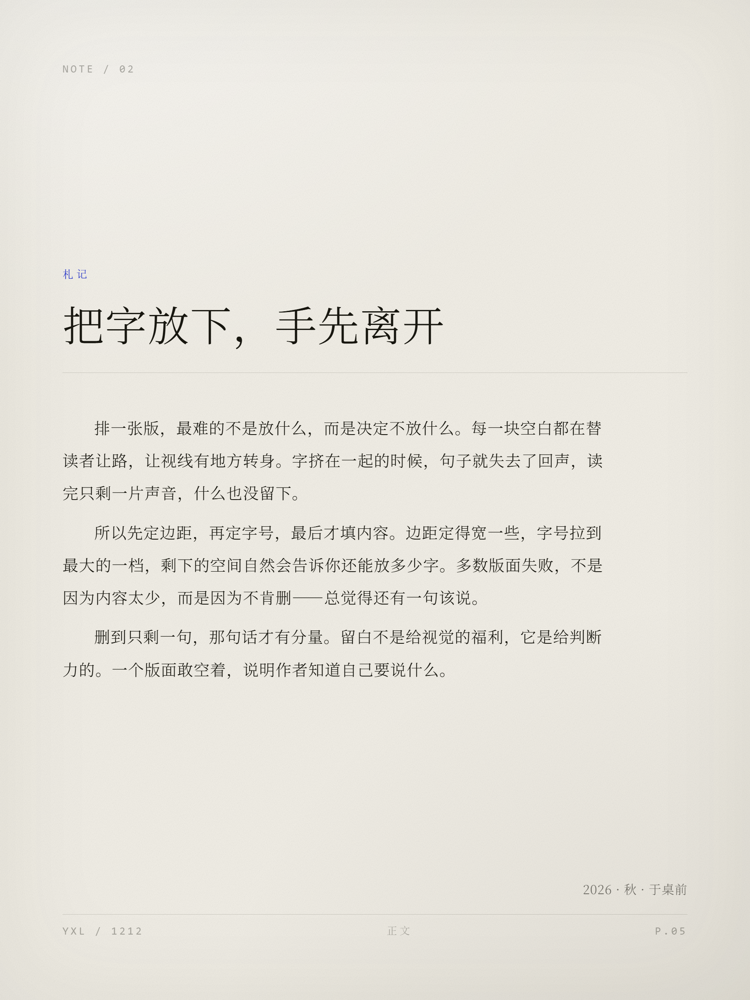
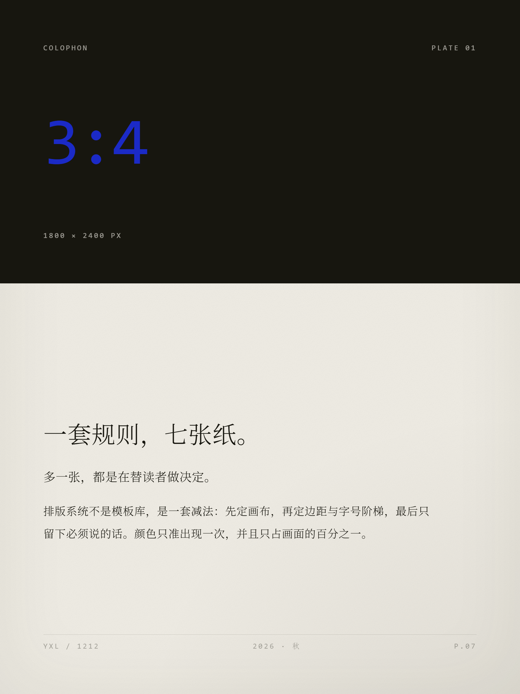
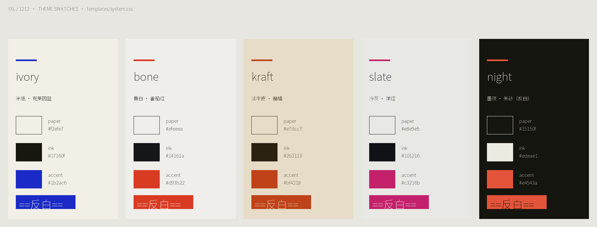

# YXL / 1212

一个 **3:4 竖版纸面排版系统**：把纯文字内容排成 1800×2400 的杂志感纸面图（PNG），**不用 AI 生图**——全部 CSS 排版 + 无头 Chrome 像素级截图。适合小红书图文 / 朋友圈长图 / 公众号头图 / 打印小样。

> 刊头 `YXL / 1212`，出自作者 Lyu 的个人排版系统。

## 设计语言

系统的每个概念都有名字、有推导：

| 概念 | 规则 |
|---|---|
| **呼吸白** | 一块内容的纵向高度 ≤ 画布高 1/3，其余全部留给纸面（1800×2400 上正文行盒 78px，8–10 行段落 ≈ 29%） |
| **墨阶** | 层次只靠三级墨色（全浓 / 六成 / 三成透明度）＋ 八级字号阶梯（22→180px，级差 ≥1.5 倍）＋ 字重 200/300 两档。零粗体、零阴影、零圆角、零渐变 |
| **朱点** | 全图唯一的高饱和强调色，只落在**文字**和**文字的底**上（染色 / 反白块 / 编号印章 / 一根竖条），最重元件每页只有一个 |
| **发丝线** | 1px 细线是唯一线条语言，只用于切分版面段落（页眉下、地脚上、封面中缝） |

## 排版风格示例

全部由本系统渲染，统一 **ivory** 主题（米纸 · 克莱因蓝），无任何 AI 生成图像：

| 封面 | 竖排宣言 | 金句 |
|:---:|:---:|:---:|
|  |  |  |

| 条目 | 正文 | 封底 |
|:---:|:---:|:---:|
|  |  |  |

行内强调语法（写在 JSON 文本里，渲染器解析）：

- `*染色*` — 关键词染强调色
- `^^放大^^` — 跳到 2 倍字号，正好塞进正文行盒，不动行距
- `==反白块==` — 强调色底 + 纸色字，跨行自动拆块
- `[[提行]]` — 一句"站起来"的短句（只能落在句界）
- `@@大字@@` — 100px 大字句，全页最响的一档，每页最多一处
- `<~压灰~>` — 降到六成墨色，给自嘲 / 旁白让位
- `\n` — 硬换行，续行自动空两格对齐

## 配色组

五套纸墨主题（`templates/system.css` 的 `.theme-*`），每套只有三个变量：纸 / 墨 / 唯一强调色：



| 主题 | 配色 |
|---|---|
| `ivory` | 米纸 · 克莱因蓝 |
| `bone` | 骨白 · 番茄红 |
| `kraft` | 淡牛皮 · 赭橘 |
| `slate` | 冷灰 · 洋红 |
| `night` | 墨夜 · 朱砂（反白） |

自定义主题用色卡工具调（三个取色器 + 实时对比度检查，`apply` 幂等写回 CSS）：

```bash
python tools/palette.py build              # → palette.html，浏览器打开
python tools/palette.py apply themes.json  # 写回 templates/system.css，新主题自动出现在标注页
```

## 工作流：一次页面完成「选配色 + 划重点」

配色组和重点标记都在**同一个标注页**里完成，不用分开操作：

```bash
# 1. 生成标注页（内置全部主题的色条，点击切换、实时预览强调色）
python tools/annotate.py build "content/<文章>/<章节>.json"

# 2. 浏览器打开 annotate.html：
#    顶栏选配色组 → 划选文字点按钮标记重点 → 导出 marks.json

# 3. 一步写回并出图（配色组写进 meta.theme，标记写回正文）
python tools/annotate.py apply "content/<文章>/<章节>.json" marks.json --render
```

## 网页版（MVP）

不想装 Python 也可以直接在浏览器里排版：粘贴文字 → 选版式/配色 → 划重点（强调语法）→ 下载 PNG。

```bash
cd web
npm install
# 字体：把 Noto Serif SC / Noto Sans SC 可变字体（TTF）放进 web/public/fonts/
npm run dev        # 开发预览 → http://localhost:5173
npm run build      # 产物在 web/dist/，可静态托管（Netlify / Vercel / GitHub Pages）
```

排版引擎是 `render.py` 七种版式的 TypeScript 1:1 移植（`web/src/plate.ts`），输出相同 DOM、套同一份 `system.css`；导出用 `html-to-image`（SVG foreignObject，浏览器原生渲染，与本地 Chrome 截图保真一致）。

## 使用

```bash
# 1. 字体：下载 Noto Serif SC / Noto Sans SC 可变字体（TTF）放进 assets/
#    @font-face 需声明 font-weight: 100 900 才能拿到细档
# 2. 复制模板改内容
cp content/template.json content/<文章>/<章节>.json
# 3. 出图
python render.py "content/<文章>/<章节>.json"
# 只出某几页 / 只看 HTML
python render.py "content/<文章>/<章节>.json" --only 1,3
python render.py "content/<文章>/<章节>.json" --html-only
```

**标注工具**（见上方「工作流」）与**色卡工具**（自定义主题）都在 `tools/`；另有 `tools/swatch.py` 生成五主题色卡总览图（`out/themes.png`）。

## 目录结构

```
render.py               # JSON → HTML → PNG（含竖排手动分列、封面自动降字号、行内强调解析）
templates/system.css    # 画布 / 八级字号 / 五套纸墨主题 / 七种版式
content/                # template.json（字段模板）、demo.json（示例）
tools/annotate.py       # 标注页：选配色组 + 划线标记 → apply 一次写回并出图
tools/palette.py        # 主题色卡：调色→对比度实时检查→写回 CSS
tools/swatch.py         # 五主题色卡总览图
web/                    # 网页版 MVP（React + Vite，纯前端，见上）
examples/               # 上面的风格示例图（ivory）+ 主题色卡
SKILL.md                # 完整使用说明 + 全部踩坑记录
```

## 七种版式

`cover` 封面 / `statement` 竖排宣言 / `quote` 金句 / `list` 条目 / `essay` 正文 / `index` 目录 / `split` 封底（上半墨色块）。字段见 `content/template.json`。
